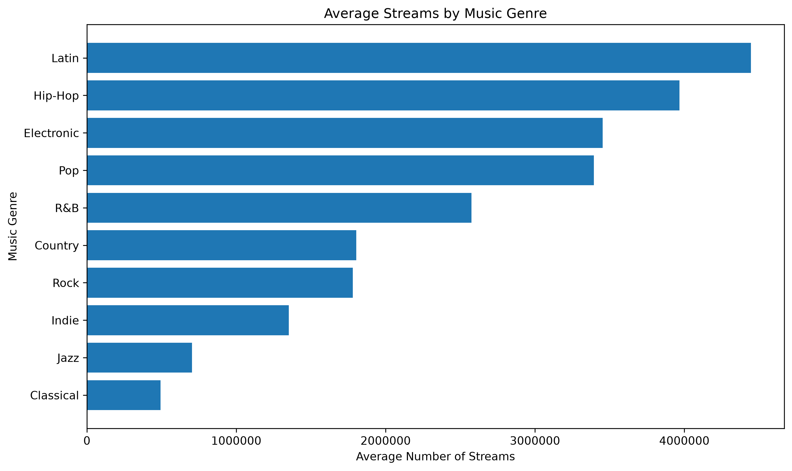
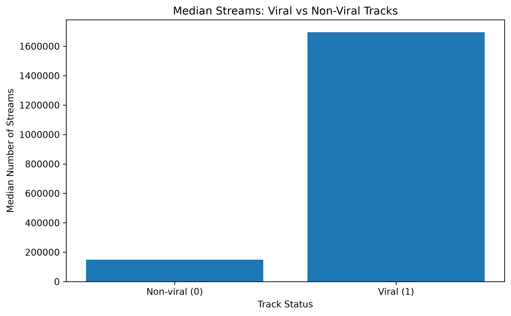
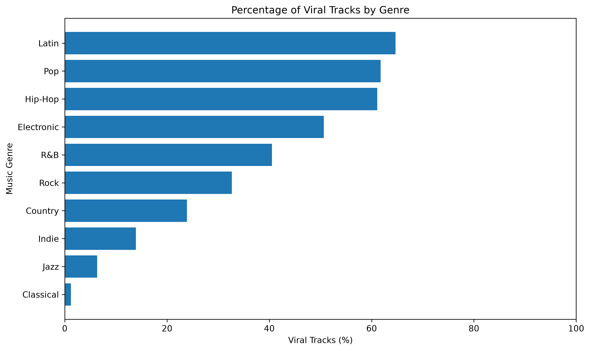
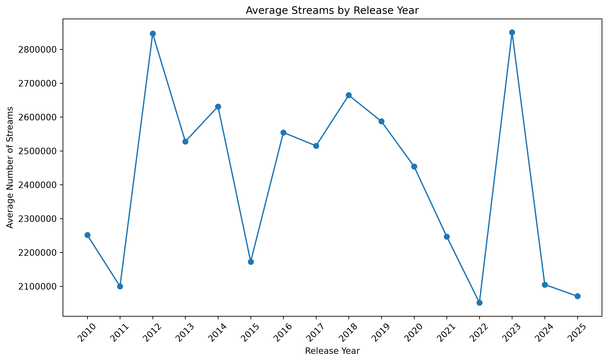

Music Streaming Analysis

1. Executive Summary

Project Overview

This project analyzes a dataset of 10,000 music tracks to identify patterns associated with streaming performance and viral status.The goal is to provide data-driven insights that can help a music streaming service make more informed marketing and promotional decisions.

Key Findings

* Genre performance: Latin has the highest average number of streams, at approximately 4.45 million per track, followed by Hip-Hop at approximately 3.97 million.
* Viral status: Tracks labeled as viral have a median of approximately 1.69 million streams, compared with approximately 149,000 for non-viral tracks.
* Audio features: Tracks labeled as viral tend to have higher average danceability and energy, as well as lower average acousticness. These are associations, not evidence of causation.
* Energy and streams: The correlation between energy and streams is very weak and positive (0.07), suggesting that energy alone is not a useful linear indicator of streaming performance in this dataset.
* Release year: Average and median streaming numbers fluctuate across release years, with no clear, consistent upward or downward pattern.

Business Implications

The results suggest that marketing teams could investigate genre-specific promotional strategies, particularly for Latin and Hip-Hop tracks. Audio features may also be useful for further investigation, but they should not be treated as reliable predictors of success without additional validation.

2. Business Problem & Objectives

Business Problem

A music streaming service wants to improve its marketing and promotional strategies. However, the relationship between music genres, audio features, viral status, and streaming performance is not fully understood.

Without a clearer understanding of these patterns, the marketing team may struggle to identify promising tracks and allocate promotional resources effectively.

Business Objectives

The objectives of this analysis are to:

1. Identify the music genres with the highest average number of streams.
2. Compare viral and non-viral tracks to identify differences in streaming performance and audio features.
3. Examine the relationship between track energy and the number of streams.
4. Analyze streaming performance across different release years.
5. Identify track characteristics associated with higher streaming numbers.

Key Business Questions

This analysis addresses five questions:

* Which music genres have the highest average streaming numbers?
* What differences can be observed between viral and non-viral tracks?
* Is track energy associated with the number of streams?
* How does streaming performance vary by release year?
* Which audio characteristics show the strongest relationships with streaming numbers?

Expected Business Value

The findings may help the marketing team develop hypotheses for genre-specific campaigns, better understand patterns in track performance, and identify areas for further investigation.

3. Dataset Overview & Data Quality

Dataset Overview

The dataset contains 10,000 music tracks and 17 columns. It includes track information, audio features, streaming numbers, and a binary viral-status label.

The dataset covers tracks released between 2010 and 2025.

The main variables used in this analysis include:

* Genre: The music genre associated with each track.
* Release year: The year the track was released.
* Audio features: Numerical measures such as danceability, energy, valence, acousticness, and instrumentalness.
* Streams: The number of streams recorded for each track.
* Viral status: A binary label, where 1 represents a track labeled as viral and 0 represents a track labeled as non-viral.

Data Quality Checks

Before conducting the analysis, the dataset was checked for missing values, duplicate records, and unique track identifiers.

The following results were observed:

* Number of records: 10,000 tracks.
* Number of columns: 17.
* Missing values: No missing values were found in the dataset.
* Duplicate records: No fully duplicated rows were found.
* Unique identifiers: All 10,000 tracks have unique track_id values.

These checks indicate that the dataset is complete with respect to missing values and does not contain fully duplicated rows. However, these checks alone do not guarantee that every value is accurate or that the dataset is representative of real-world streaming activity.

Distribution of Streaming Numbers

The mean number of streams is approximately 2.42 million, while the median is approximately 329,000.

The substantial difference between the mean and median suggests that the distribution of streaming numbers is right-skewed. In other words, a relatively small number of tracks may have much higher streaming numbers than the majority of tracks.

Because of this difference, both the mean and median are useful when comparing streaming performance. The median can provide a more representative view of a typical track when extremely high values influence the mean.

High streaming values should not automatically be treated as errors or removed as outliers. Further investigation would be needed to determine whether these values are valid.

Data Limitations

The definition and criteria used to assign the viral-status label are not documented in this analysis. Therefore, the exact meaning of the label cannot be independently verified.

This limitation is important when interpreting relationships between viral status and streaming numbers or audio features. The observed patterns should be treated as associations rather than evidence that a particular audio feature causes a track to become viral.

4. Exploratory Data Analysis (EDA)

Analysis Methods

The following methods were used:

* Descriptive statistics: Calculated counts, means, and medians to summarize key variables.
* Group comparisons: Compared streaming performance and audio features across different groups, including genres and viral-status categories.
* Correlation analysis: Examined linear relationships between numerical variables, particularly audio features and streaming numbers.
* Time-based comparison: Compared average and median streaming numbers across release years.
* Data visualization: Created charts to make patterns and differences easier to interpret.

Key Observations

The exploratory analysis revealed several patterns:

1. Genre differences: Latin and Hip-Hop tracks had the highest average streaming numbers in the dataset.
2. Viral status: Tracks labeled as viral had substantially higher average and median streaming numbers than tracks labeled as non-viral.
3. Audio features: Viral tracks had higher average danceability, energy, and valence, while their average acousticness was lower.
4. Energy and streams: Energy showed a very weak positive correlation with streaming numbers.
5. Release years: Average and median streaming numbers fluctuated across release years without a consistent upward or downward pattern.

Interpretation and Limitations

These observations help identify patterns that may be relevant to the marketing team. However, exploratory analysis does not establish causation or guarantee that the observed relationships will hold in other datasets.

Streaming numbers are highly skewed, so averages may be influenced by tracks with exceptionally high stream counts. Median values were therefore also considered when comparing groups.

In addition, the criteria used to assign viral status are unknown. The relationship between viral status and streaming numbers should be interpreted with this limitation in mind.

5. Genre Performance Analysis

Business Question

Which music genres have the highest average streaming numbers?

Methodology

To answer this question, tracks were grouped by genre. The mean, median, and total number of streams were calculated for each genre.

The mean was used to compare average streaming performance, while the median helped assess the typical streaming performance of a track within each genre. Total streams were also considered to understand the overall contribution of each genre to the dataset.

Results

Latin had the highest average number of streams, at approximately 4.45 million per track. Hip-Hop ranked second, with approximately 3.97 million average streams.

Electronic ranked third, with approximately 3.45 million average streams, followed closely by Pop at approximately 3.39 million.

At the lower end of the ranking, Jazz had approximately 703,000 average streams, while Classical had the lowest average, at approximately 492,000.

The median results provided additional context. Latin had the highest median, at approximately 895,000 streams, followed by Hip-Hop at approximately 779,000. Although Electronic had a higher average than Pop, Pop had a higher median. This difference suggests that unusually high streaming values may have a greater influence on the average for Electronic tracks.

Key Findings

* Latin had the highest average and median streaming numbers among the genres analyzed.
* Hip-Hop ranked second in average streams and had the second-highest median.
* Electronic had a slightly higher average than Pop, but Pop had a higher median.
* Classical had the lowest average streaming performance in the dataset.
* Differences between means and medians indicate that streaming distributions may be influenced by tracks with exceptionally high stream counts.

Business Implications

The results suggest that Latin and Hip-Hop may be promising genres for further marketing investigation. A streaming service could explore whether genre-specific campaigns, audience targeting, and playlist placement strategies improve engagement for these genres.

However, average streaming numbers alone are not sufficient to determine promotional priorities. The marketing team should also consider audience size, campaign costs, listener retention, and the incremental streams generated by promotion.

Limitations

These results describe the dataset and do not establish that genre causes higher streaming performance. Other factors, such as artist popularity, playlist placement, marketing exposure, and track release timing, may also influence the number of streams.

Further analysis using platform-level business data would be needed before making major marketing investment decisions.

### Visualization

6. Viral vs. Non-Viral Tracks Analysis

Business Question

What differences can be observed between viral and non-viral tracks?

Methodology

Tracks were divided into two groups based on the viral column:

* viral = 1: Tracks labeled as viral.
* viral = 0: Tracks labeled as non-viral.

The number of tracks, mean and median streams, and average audio-feature values were compared between the two groups.

Streaming Performance

The dataset contained 3,605 tracks labeled as viral and 6,395 tracks labeled as non-viral.

The mean number of streams was approximately 5.86 million for viral tracks, compared with approximately 471,000 for non-viral tracks.

The median was approximately 1.69 million streams for viral tracks and 149,000 for non-viral tracks. This means that the median streaming count for viral tracks was approximately 11.4 times higher than that for non-viral tracks.

These results demonstrate a substantial difference in streaming numbers between the two groups within this dataset.

Audio Feature Comparison

Viral tracks had higher average values for several audio features:

* Danceability: 0.711 for viral tracks versus 0.556 for non-viral tracks.
* Energy: 0.727 versus 0.609.
* Valence: 0.631 versus 0.555.

Viral tracks also had lower average acousticness, at 0.170 compared with 0.367 for non-viral tracks.

Average instrumentalness was slightly lower for viral tracks, at 0.162 versus 0.186.

These differences suggest that the two groups have distinct audio-feature profiles in the dataset. However, the analysis does not establish that any of these features directly causes a track to become viral.

Key Findings

* Tracks labeled as viral had substantially higher mean and median streaming numbers.
* Viral tracks had higher average danceability, energy, and valence.
* Viral tracks had lower average acousticness and slightly lower average instrumentalness.
* The observed differences identify potential areas for further investigation, but they do not establish reliable predictors of viral success.

Business Implications

The marketing team could investigate whether audio features provide useful additional information when evaluating tracks for promotion.

For example, the team could test whether audio features improve the performance of a model that identifies tracks likely to achieve strong streaming results. Such a model should be evaluated on separate data and compared against a suitable baseline before being used in business decisions.

Limitations

The criteria used to assign the viral-status label are unknown. If the label was assigned partly or entirely based on streaming performance, the difference in streams between the groups may be inherent in the label’s definition.

Therefore, the streaming comparison should not be interpreted as evidence that viral status independently causes higher streaming numbers. Similarly, the observed audio-feature differences do not prove that those characteristics cause a track to become viral.

### Visualizations

7. Energy vs. Streams Analysis

Business Question

Is track energy associated with the number of streams?

Methodology

To investigate this question, the Pearson correlation coefficient was calculated between the energy and streams variables.

The Pearson correlation coefficient measures the direction and strength of a linear relationship between two numerical variables. Its values range from -1 to +1.

Results

The correlation coefficient between energy and streams was approximately 0.07.

This indicates a very weak positive linear relationship between the two variables. In this dataset, tracks with higher energy scores do not consistently have substantially higher streaming numbers based on this measure.

Key Finding

Energy alone does not appear to be a useful indicator of streaming performance through a linear relationship in this dataset.

Business Implications

The marketing team should avoid using energy as a standalone indicator when evaluating a track’s potential streaming performance.

Other factors, such as genre, artist popularity, playlist placement, marketing exposure, and listener preferences, may also be relevant. Further analysis would be needed to determine whether combinations of these factors provide more useful insights.

Limitations

Correlation does not establish causation. The observed coefficient describes a linear relationship and does not rule out nonlinear relationships or interactions with other variables.

In addition, streaming numbers are highly skewed, which may affect the interpretation of correlation results. Further analysis would be needed to investigate these patterns in greater detail.

8. Streaming Performance by Release Year

Business Question

How does streaming performance vary by release year?

Methodology

Tracks were grouped by release year. The mean and median number of streams were calculated for each year to compare streaming performance over time.

The number of tracks released in each year was also examined to understand the size of each year’s sample.

Results

Streaming performance varied across release years, with no consistent upward or downward pattern in the mean number of streams.

The highest average streaming count was observed for tracks released in 2023, at approximately 2.85 million streams. Tracks released in 2012 had a similar average of approximately 2.85 million.

The highest median streaming count was observed for tracks released in 2021, at approximately 408,000 streams.

For tracks released in 2025, the average was approximately 2.07 million streams, while the median was approximately 316,000.

The differences between yearly means and medians indicate that unusually high streaming values may influence the average in some years.

Key Findings

* Average streaming numbers fluctuated across release years.
* Tracks released in 2023 had the highest average streaming count in the dataset.
* Tracks released in 2021 had the highest median streaming count.
* No consistent upward or downward trend was observed across the period from 2010 to 2025.

Business Implications

The marketing team could use these findings as a starting point for investigating how release timing relates to streaming performance.

However, release year alone should not be used to determine promotional priorities. Other factors, including track age, artist popularity, genre, playlist placement, and marketing exposure, may influence streaming numbers.

Limitations

The analysis compares streaming totals across release years but does not account for the amount of time each track has been available to accumulate streams.

Consequently, newer tracks may have had less time to generate streams than older tracks. A more detailed analysis would need to account for track age and, ideally, compare streams accumulated over equivalent periods after release.

### Visualization

9. Audio Features and Streaming Performance

Business Question

Which audio characteristics show the strongest relationships with streaming numbers?

Methodology

Pearson correlation coefficients were calculated between streaming numbers and five audio features: danceability, energy, valence, acousticness, and instrumentalness.

The coefficients were used to compare the direction and strength of linear relationships between each feature and the number of streams.

Results

All five audio features showed weak linear correlations with streaming numbers.

Danceability had the strongest positive correlation among the features examined, with a coefficient of 0.12. Energy had a correlation of 0.07, while valence had a correlation of 0.05.

Acousticness showed a weak negative correlation of -0.10. Instrumentalness had a correlation of -0.01, indicating an almost negligible linear relationship with streaming numbers.

Overall, none of the examined audio features demonstrated a strong linear relationship with streams in this dataset.

Key Findings

* Danceability had the strongest positive linear correlation with streams among the five audio features, although the relationship was weak.
* Acousticness had a weak negative correlation with streams.
* Energy and valence had very weak positive correlations with streams.
* Instrumentalness had an almost negligible linear correlation with streams.

Business Implications

The results suggest that the marketing team should not rely on individual audio features as standalone indicators of streaming performance.

Further analysis could investigate whether combinations of audio features, genre, artist popularity, and promotional exposure provide more useful information.

A predictive model could also be explored in a future project, provided that sufficient data is available and its performance is properly evaluated.

Limitations

Pearson correlation measures linear relationships and does not establish causation. Weak correlations do not rule out nonlinear relationships or interactions between variables.

The analysis also does not control for other factors that may influence streaming numbers, such as artist popularity, playlist placement, marketing campaigns, or track age.

Therefore, these results should be interpreted as exploratory findings rather than evidence that the examined audio features can reliably predict streaming performance.

10. Conclusions & Business Recommendations

Overall Conclusions

This project analyzed 10,000 music tracks to explore streaming performance, genre differences, viral status, audio features, and release years.

The analysis identified several patterns within the dataset:

* Genre performance: Latin had the highest average and median streaming numbers, followed by Hip-Hop.
* Viral status: Tracks labeled as viral had substantially higher average and median streams than tracks labeled as non-viral.
* Audio features: Viral tracks had higher average danceability, energy, and valence, as well as lower average acousticness.
* Energy and streams: The correlation between energy and streams was very weak and positive, at 0.07.
* Release year: Streaming performance fluctuated across release years without a consistent upward or downward pattern.
* Audio features and streams: None of the five examined audio features showed a strong linear correlation with streaming numbers.

Overall, the results suggest that streaming performance is not well explained by any single audio feature examined in this analysis.

Business Recommendations

Based on the findings, the following actions could be considered:

1. Investigate genre-specific marketing opportunities

Latin and Hip-Hop had the highest average streaming numbers in the dataset. The marketing team could investigate audience engagement, campaign performance, and promotional opportunities within these genres before allocating additional resources.

2. Investigate the characteristics of high-performing tracks

The differences between viral and non-viral tracks suggest potential areas for further research. The team could examine whether audio features provide additional useful information when combined with genre, artist popularity, and promotional exposure.

3. Avoid relying on energy alone

The very weak correlation between energy and streams suggests that energy should not be used as a standalone indicator of streaming performance.

4. Account for track age when comparing release years

Comparisons across release years should consider how long tracks have been available to accumulate streams. Comparing streams over equivalent periods after release would provide a more meaningful assessment.

5. Validate findings using business data

Before making major marketing decisions, the team should validate these findings using actual platform data, campaign costs, listener engagement, and other relevant business metrics.

Project Limitations

This analysis has several limitations:

* The dataset may not represent the entire music streaming market.
* The criteria used to assign viral status are unknown.
* Correlation analysis does not establish causation.
* The analysis does not control for factors such as artist popularity, playlist placement, marketing exposure, or track age.
* Streaming counts alone do not measure campaign profitability or return on investment.

Final Conclusion

This project demonstrates how data analysis can help identify patterns in music streaming performance and translate them into questions relevant to business decision-making.

The findings provide a starting point for further investigation rather than definitive evidence of what causes a track to succeed. Additional data and validation would be required before using these results to predict performance or make substantial marketing investments.